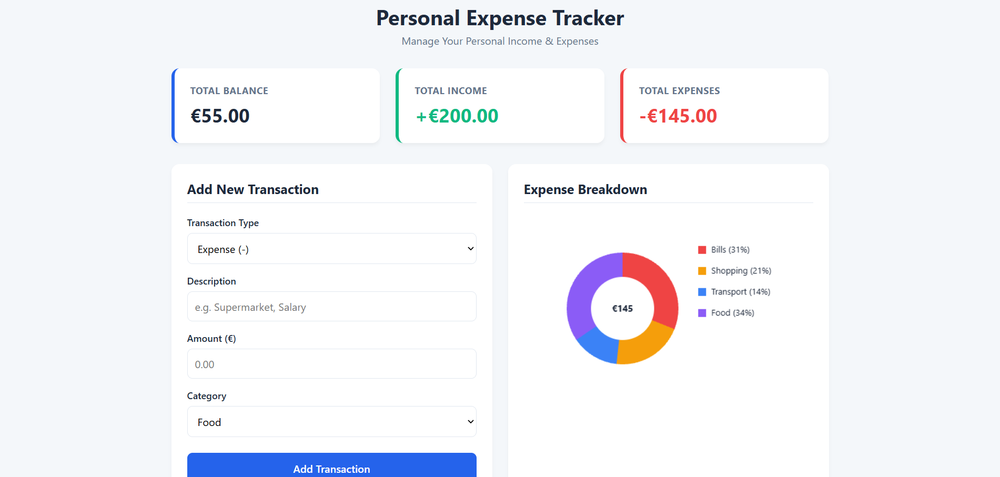

# Personal Expense Tracker

A lightweight, responsive web application built from scratch using **Vanilla JavaScript**, **HTML5**, and **CSS3** to track personal income and expenses in real time. Designed with zero external dependencies, featuring a custom-built data visualization engine using the **HTML5 Canvas API**.

🔗 **Live Demo:** [View Live Application](https://sotia-dev.github.io/personal-expense-tracker/)




---

## Key Features

- **Real-Time Financial Summary:** Automatically calculates and updates **Total Balance**, **Total Income**, and **Total Expenses** with every transaction.
- **Income & Expense Tracking:** Add transactions with custom descriptions, amounts, and automatic date stamping (`DD/MM/YYYY`).
- **Category-Based Organization:** Categorize expenses into *Food, Transport, Shopping, Bills, Entertainment,* or *Other* (dynamically hidden when adding income).
- **Custom HTML5 Canvas Doughnut Chart:** Visualizes expense distribution by category with dynamically calculated percentages, color-coded legends, and total expense display—built natively without third-party charting libraries.
- **Persistent State Management:** Leverages the browser's `LocalStorage` API so user transactions remain saved across page reloads and browser sessions.
- **Transaction Management:** Delete individual entries or clear the entire transaction history with confirmation prompts.
- **Responsive UI:** Clean, modern layout built with CSS Grid and Flexbox that adapts seamlessly to desktop, tablet, and mobile screens.

---

## Tech Stack

- **HTML5:** Semantic structure and `<canvas>` element for graphical rendering.
- **CSS3:** Custom CSS variables, CSS Grid, Flexbox, and responsive media queries.
- **JavaScript (ES6+):** DOM manipulation, event handling, array methods (`filter`, `reduce`, `forEach`), `LocalStorage` API, and 2D Canvas math (`Math.PI`).

---

## How It Works

1. **State Initialization:** On load, the app retrieves existing transactions from `localStorage` (or initializes an empty array).
2. **Adding Transactions:** Submitting the form validates user input, creates a transaction object with a unique timestamp ID (`Date.now()`), saves it to `localStorage`, and triggers a full UI re-render (`updateUI()`).
3. **Data Visualization:** The `updateChart()` function aggregates expenses per category, calculates each category's share of total spending in radians, and renders a doughnut chart with a dynamic legend directly onto the HTML5 `<canvas>`.

---

## Project Structure

```text
personal-expense-tracker/
├── index.html      # Application structure and layout
├── style.css       # Styling, variables, and responsive design
├── script.js       # Core logic, LocalStorage, and Canvas chart rendering
└── README.md       # Project documentation
```

---

## How to Run Locally

1. Clone the repository:
   ```bash
   git clone https://github.com/sotia-dev/personal-expense-tracker.git
   ```
2. Navigate to the project folder and open `index.html` in any modern web browser.
